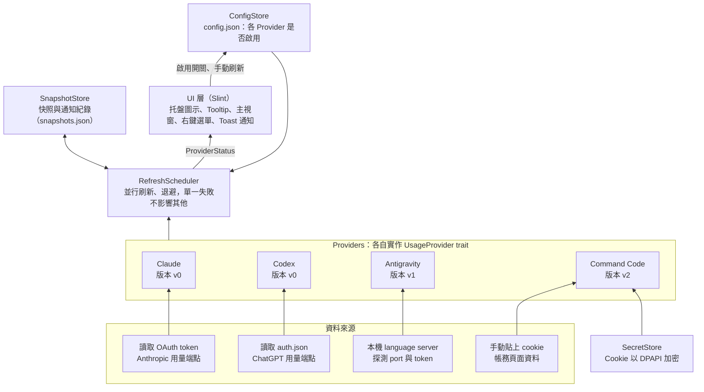
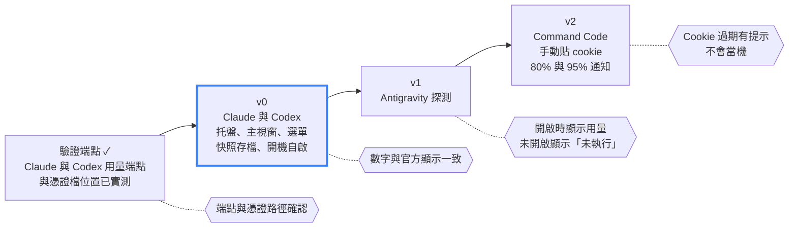

# Windows AI 用量托盤工具 規格書

Nov 9, 2026 · @Ray（2026-11-09 依規劃訪談結果修訂；名詞定義見根目錄 `CONTEXT.md`，架構決策見 `docs/adr/`）

## 1. 概述與目標

本專案是 Windows 系統匣常駐的小工具，讓使用者不用開網頁或 CLI，就能一眼看到 Claude、Codex 等 AI 服務的訂閱額度用量與重置時間。靈感來自 macOS 的 CodexBar，但範圍刻意縮小，只做自己需要的功能。

**要解決的問題**：訂閱方案的額度（例如 5 小時視窗、每週額度）分散在各家網頁或 CLI 內，要查就得切換視窗，常常用到被限速才發現。

**目標**

- 在系統匣看到最高用量，顏色隨用量變化。
- 點擊托盤圖示開啟主視窗，以卡片與進度條顯示每個 Provider 的各個額度視窗與重置倒數；開啟視窗時資料是新的。
- 免輸入密碼：借用 CLI 已登入的 OAuth token。
- 最輕量：單一 Rust 執行檔（exe）、免安裝 runtime、無背景服務、無資料庫。
- 所有使用者設定都從托盤選單操作，使用者不需要編輯任何檔案。

**支援的 Provider**：Claude（訂閱）、Codex（訂閱）、Antigravity、Command Code。

**成功標準**

- v0 完成後，Claude 與 Codex 用量能正確顯示（首次使用 Rust，時程預留緩衝）。
- 資料與官方網頁或 CLI 顯示的用量誤差在一個背景刷新週期內；開啟視窗時誤差在 30 秒內。
- 視窗隱藏時常駐記憶體盡量壓低、閒置時 CPU 接近 0，啟動後數秒內出現托盤圖示（具體數值待開發後實測再定）。

## 2. 範圍

分三個版本逐步交付，v0 只做 Claude 與 Codex，因為這兩個是訂閱方案且資料來源最明確。

| 版本 | 內容 | 驗收標準 |
| --- | --- | --- |
| v0 | Claude、Codex Provider；托盤圖示（顏色隨最高用量變化、警示標記、灰色）；主視窗顯示各額度視窗用量與重置倒數；背景每 5 分鐘刷新、開啟視窗時自動刷新；手動刷新；失敗時保留快照並顯示失敗原因；快照存檔（重開機後仍可顯示）；429 退避；右鍵選單（Provider 啟用開關、立即刷新、開機自啟、關於、結束） | 兩個 Provider 的數字與官方顯示一致 |
| v1 | Antigravity Provider（本機 language server 探測） | Antigravity 開啟時能顯示用量，未開啟時顯示「未執行」 |
| v2 | Command Code Provider（手動貼 cookie，DPAPI 加密儲存）；80% 與 95% 的 Windows Toast 通知 | Cookie 過期時有明確提示，不會當機 |

**刻意不做**

- 用量歷史圖表與獨立的設定視窗（主視窗只顯示目前用量，設定只放在右鍵選單）。
- 可調整的刷新間隔與通知門檻（固定為程式常數）。
- 瀏覽器 cookie 自動匯入（Windows 上 Chromium cookie 加密複雜，是最大的工程黑洞）。
- Token refresh 流程（見 ADR-0001；過期時提示使用者先執行一次對應 CLI）。
- 超額付費（Claude 的 `spend`、`extra_usage`）的顯示。
- CodexBar 的其他 50 多個 Provider、Widget、Provider 狀態頁輪詢。
- macOS 與 Linux 支援。

## 3. 技術選型

採用 Rust 搭配 Slint，目標是啟動快、常駐記憶體少、單一 exe 免安裝 runtime，同時有能畫出卡片與進度條的好看 UI。

| 項目 | 選擇 | 理由 |
| --- | --- | --- |
| 語言 | Rust（stable） | 原生編譯、無 runtime，啟動快、記憶體低；也是開發者想接觸的新語言 |
| UI | Slint 1.18 以上 | 宣告式 UI，內建 `SystemTrayIcon` 與 `Tooltip` 元素，Windows 上以 `Shell_NotifyIconW` 實作托盤，不需另外裝托盤套件 |
| HTTP | `ureq`（同步） | 每 5 分鐘只打少量請求，搭配背景執行緒即可，不引入 tokio，減少體積與複雜度 |
| JSON | `serde` + `serde_json` | Rust 事實標準，設定檔、快照檔與 API 回應共用 |
| Windows API | `windows` crate | DPAPI 加密、登錄檔（開機自啟）、行程探測（Antigravity） |
| 渲染器 | 先用軟體渲染器 | 記憶體最省；實測後再決定是否改用 GPU 渲染器 |
| 發佈 | `cargo build --release` | 單一 exe；release 設定開啟 LTO、`strip`、`panic = "abort"` 縮小體積 |

**授權**：採用 Slint 的 **Royalty-free** 授權，可用於不公開原始碼的桌面應用，條件是揭露使用 Slint：右鍵選單提供「關於」，開啟後顯示 `AboutSlint` 元件。

**替代方案（未採用）**

- Tauri v2（Rust + WebView2）：UI 最自由，但開啟視窗時 WebView2 的記憶體較高。
- egui：很輕，但外觀偏工具風，不易做出好看的卡片。
- C# WinForms / WPF：開發最快，但需要 .NET runtime，啟動與記憶體較重，WinForms 也很難做出好看的 UI。

## 4. 系統架構



資料由下往上流動：Provider 取得資料並轉成統一的快照，排程器負責刷新與退避，並把每個 Provider 的「快照＋最近失敗原因」交給 UI；UI 只讀取結果，並把使用者的啟用開關寫回設定。新增 Provider 只需新增一個實作 `UsageProvider` trait 的結構。

## 5. Provider 規格

四個 Provider 都不要求使用者輸入帳密：Claude 與 Codex 借用 CLI 已登入的 OAuth token，Antigravity 探測本機行程，Command Code 使用手動貼上的 cookie。Claude 與 Codex 的端點已於 2026-11-09 實測確認（非公開端點，仍可能改版）。

| Provider | 版本 | 認證來源 | 取得方式 | 方案名稱 |
| --- | --- | --- | --- | --- |
| Claude | v0 | `%USERPROFILE%\.claude\.credentials.json` 的 `claudeAiOauth.accessToken`（`expiresAt` 為毫秒，壽命約 8 小時） | `GET https://api.anthropic.com/api/oauth/usage`，header：`Authorization: Bearer <token>`、`anthropic-beta: oauth-2025-04-20` | `claudeAiOauth.subscriptionType` + `rateLimitTier`（例：`max` + `default_claude_max_5x` → 「Max 5x」） |
| Codex | v0 | `%USERPROFILE%\.codex\auth.json` 的 `tokens.access_token`、`tokens.account_id`（JWT，壽命約 10 天） | `GET https://chatgpt.com/backend-api/wham/usage`，header：`Authorization: Bearer <token>`、`ChatGPT-Account-Id: <account_id>` | 回應的 `plan_type`（例：`plus` → 「Plus」） |
| Antigravity | v1 | 無（本機探測） | 用 WMI 找出 language server 行程，從命令列取得 port 與 token，呼叫本機端點（待驗證） | 待驗證 |
| Command Code | v2 | 使用者手動貼上的瀏覽器 cookie | 以 cookie 取得每月美金額度（billing 頁面資料，待驗證） | 待驗證 |

**Claude 回應解析**

- 優先解析 `limits` 陣列，每筆為一個額度視窗：`kind`（`session`、`weekly_all`、`weekly_scoped`…）、`percent`、`resets_at`（ISO 8601）、`scope.model.display_name`。
- 視窗名稱：`session` →「5 小時」、`weekly_all` →「每週」、`weekly_scoped` →「每週・{display_name}」；未知的 `kind` 仍顯示，名稱用 `kind` 原字串。
- `limits` 不存在時，退回解析舊欄位 `five_hour`、`seven_day`（`utilization`、`resets_at`）；兩者皆無法解析才視為「回應格式改變」。
- 其餘欄位（`spend`、`extra_usage`、各種代號欄位）忽略。

**Codex 回應解析**

- `rate_limit.primary_window` 與 `rate_limit.secondary_window`：`used_percent`、`limit_window_seconds`、`reset_at`（Unix 秒）。
- 視窗名稱由 `limit_window_seconds` 推得：18000 →「5 小時」、604800 →「每週」，其他值換算成小時或天數。
- `additional_rate_limits` 有值時一併顯示。

**共通規則**

- API 回傳幾個額度視窗就顯示幾個，不寫死清單；0% 的視窗照樣顯示。
- 每次刷新都重新讀取憑證檔，CLI 更新憑證後下一次刷新即生效。
- Token 過期時不自行 refresh（ADR-0001），顯示「Token 已過期，請先執行一次 `claude`（或 `codex`）」。若憑證檔的到期時間已過，直接判定過期，不發送請求。
- 絕不寫入或修改 CLI 的憑證檔，只讀取。
- 每個 Provider 的端點細節集中在各自的模組（`providers/<name>.rs`），端點改版時只需修改一個檔案。

## 6. 資料模型

每個 Provider 的顯示內容由兩部分組成：**快照**（最後一次成功取得的資料）與**最近一次刷新的失敗原因**。抓取失敗不會覆蓋快照，所以卡片永遠能顯示最後已知的數字。

```rust
pub trait UsageProvider: Send + Sync {
    fn id(&self) -> &'static str;
    fn display_name(&self) -> &'static str;
    /// 憑證檔是否存在（只檢查檔案，不讀內容）；用於首次啟動自動偵測
    fn credentials_present(&self) -> bool;
    fn fetch(&self) -> Result<Snapshot, FetchFailure>;
}

#[derive(Clone, Debug, Serialize, Deserialize)]
pub struct Snapshot {
    pub plan: Option<String>,              // 方案名稱，例如「Max 5x」「Plus」
    pub account_hash: String,              // 帳號識別的雜湊，不存原始 id
    pub windows: Vec<UsageWindow>,
    pub credits: Option<Credits>,          // v2：Command Code 這類以金額計的 Provider
    pub fetched_at: SystemTime,
}

#[derive(Clone, Debug, Serialize, Deserialize)]
pub struct UsageWindow {
    pub name: String,                      // 例如「5 小時」「每週」「每週・Fable」
    pub used_percent: f64,                 // 0.0–100.0
    pub resets_at: Option<SystemTime>,
}

#[derive(Clone, Debug)]
pub enum FetchFailure {
    NotLoggedIn,                           // 找不到憑證檔
    TokenExpired,                          // 憑證到期時間已過，或回應 401／403
    RateLimited { retry_at: SystemTime },  // 回應 429
    Network,                               // 逾時、連線失敗、5xx
    BadResponse,                           // 回應格式無法解析
    NotRunning,                            // v1：Antigravity 未執行
}

/// 排程器交給 UI 的每個 Provider 狀態
#[derive(Clone, Debug)]
pub struct ProviderStatus {
    pub provider_id: &'static str,
    pub snapshot: Option<Snapshot>,
    pub last_failure: Option<FetchFailure>, // 最近一次刷新成功時為 None
    pub refreshing: bool,
}
```

**衍生規則**

| 概念 | 規則 |
| --- | --- |
| 已重置 | 額度視窗的 `resets_at` 已過，用量視為 0%，卡片顯示「已重置」 |
| 舊快照 | `fetched_at` 超過 3 個背景刷新週期（15 分鐘） |
| 帳號不符 | 啟動時讀到的快照 `account_hash` 與目前憑證不同，丟棄該快照 |

## 7. UI 與互動

UI 由托盤圖示、Tooltip、右鍵選單與一個主視窗組成，皆以 Slint 繪製。只顯示**啟用**的 Provider。主視窗採一般視窗而非彈出面板，理由見 ADR-0002。

**托盤圖示**

- 顏色取所有啟用 Provider 的最高用量，舊快照也計入，但已重置的額度視窗以 0% 計：低於 70% 綠色、70% 至 90% 黃色、90% 以上紅色。
- 任一啟用的 Provider 有失敗原因時，圖示疊加警示標記。
- 所有啟用 Provider 的快照都是舊快照（或沒有快照）時，圖示改為灰色。
- 圖示不顯示數字；由程式繪製（綠、黃、紅、灰 × 有無警示），不需另備圖檔。主視窗的工作列圖示與托盤圖示同步。
- Tooltip：每個啟用 Provider 一行，列出其用量最高的額度視窗，例如「Claude 61%（5 小時）」「Codex 75%（5 小時）」。

**主視窗**

- 一般視窗：有標題列，可拖動、可調整大小（最小 360×200）；程式啟動時不顯示，只有托盤。
- 左鍵點擊托盤圖示：視窗不在最前面時顯示並移到最前面，已在最前面則隱藏。點托盤會讓視窗先失焦，故失焦 400ms 內仍視為在最前面。
- 按 X 或 Esc 隱藏回托盤，不結束程式；結束只從右鍵選單。
- 第一次開啟時出現在游標所在螢幕工作區的右下角；之後保留使用者拖到的位置與大小（目前僅限本次執行，之後存入 `config.json`）。
- 顯示後約 30ms 以 `SetForegroundWindow` 取得前景（托盤點擊後 Shell 會授予前景權限）。
- 視窗只建立一次，隱藏時保留；不在每次開啟時重建（重建會經過預設大小的過渡，造成位置跳動與畫面殘缺）。
- 開啟時，若某 Provider 的快照超過 30 秒且不在退避期間，自動刷新該 Provider。
- 頂部工具列有「↻ 立即刷新」按鈕；內容超出視窗高度時捲動。
- 每個 Provider 一張精簡卡片：標題列為名稱、方案標籤（例如「Max 5x」），右側為「更新於 N 分鐘前」（刷新中改為轉圈圖示）；每個額度視窗一行：名稱｜進度條｜百分比｜重置時間。
- 重置時間（每行最右欄，省略「重置」二字）：24 小時內顯示相對時間（「2 時 13 分後」），超過 24 小時顯示日期時間（「11/12（四）14:59」），重置時間已過顯示「已重置」。
- 進度條與百分比顏色沿用托盤圖示的門檻（綠、黃、紅）。
- 金額型 Provider（v2 Command Code）顯示「已用 / 額度」的美金數字與進度條。
- 「更新於 N 分鐘前」與重置倒數每 30 秒重新計算。
- 配色跟隨 Windows 深色／淺色模式。

**卡片顯示規則**

| 情況 | 卡片顯示 |
| --- | --- |
| 有快照、刷新成功 | 各額度視窗與「更新於 N 分鐘前」 |
| 有快照、最近一次刷新失敗 | 照樣顯示快照與取得時間，另加一行失敗原因 |
| 沒有快照 | 只顯示失敗原因，不顯示進度條 |
| 刷新中 | 保留目前數字，卡片角落顯示轉圈圖示 |

**失敗原因文字**

| 失敗原因 | 文字 |
| --- | --- |
| `NotLoggedIn` | 找不到登入資訊，請先執行 `claude`（或 `codex`） |
| `TokenExpired` | Token 已過期，請先執行一次 `claude`（或 `codex`） |
| `RateLimited` | 限流中，HH:MM 自動重試 |
| `Network` | 無法連線，下次排程將重試 |
| `BadResponse` | 回應格式改變 |
| `NotRunning` | 未執行（Antigravity） |

**右鍵選單**

- 各 Provider 的啟用開關（勾選項目；取消即不顯示、不連線、不影響托盤顏色）
- 立即刷新
- 開機自啟（勾選）
- 關於（顯示 `AboutSlint`）
- 結束

**通知（v2）**

- 每個額度視窗跨過 80% 與 95% 時各發一次 Windows Toast；該視窗重置後才會再次通知（Toast 使用的 crate 待選）。
- 已通知紀錄存於 `snapshots.json`，重開機不重複通知。

## 8. 設定、儲存與資安

程式只讀取 CLI 已有的憑證；自己寫入的檔案都在 `%APPDATA%\AiBar\`，唯一需要保管的機密是 Command Code 的 cookie（v2），以 DPAPI 加密後存放。

| 檔案 | 內容 | 說明 |
| --- | --- | --- |
| `config.json` | 各 Provider 是否啟用 | 由右鍵選單讀寫，使用者不需編輯 |
| `snapshots.json` | 各 Provider 的快照、v2 的已通知紀錄 | 每次刷新成功時寫入，啟動時讀取；讀不到或格式錯誤時視為沒有快照 |
| `aibar.log` | 日誌 | 超過 1 MB 改名為 `aibar.log.old`，最多保留兩份 |
| `secrets.bin` | Command Code cookie（v2） | `CryptProtectData`（範圍 `CurrentUser`）加密 |

```json
{
  "providers": {
    "claude": { "enabled": true },
    "codex": { "enabled": true },
    "antigravity": { "enabled": false },
    "commandcode": { "enabled": false }
  }
}
```

- 首次啟動（`config.json` 不存在）：憑證檔存在的 Provider 預設啟用，其餘停用，結果寫入 `config.json`；之後只依 config。
- 刷新間隔（5 分鐘）、開啟視窗自動刷新門檻（30 秒）、顏色門檻（70／90）、通知門檻（80／95）皆為程式常數，不可設定。
- 開機自啟以登錄檔為唯一來源：`HKCU\Software\Microsoft\Windows\CurrentVersion\Run`，選單勾選狀態直接讀寫登錄檔，不需系統管理員權限。

**機密處理原則**

1. Claude 與 Codex 的 token 只在記憶體中使用，不複製、不寫入任何檔案、不寫入日誌。
2. 絕不修改 CLI 的憑證檔，避免破壞使用者登入狀態。
3. `snapshots.json` 不含 token、email、原始帳號 id；帳號只存雜湊值（Claude 用 `organizationUuid`、Codex 用 `account_id`）。
4. Command Code cookie 以 `CryptProtectData`（範圍 `CurrentUser`）加密後存於 `secrets.bin`。
5. 日誌不記錄 token、cookie 或回應內容，只記錄 Provider、狀態碼與耗時。
6. 網路請求僅連向各 Provider 的官方網域，不使用任何第三方分析或回報服務。

## 9. 刷新與錯誤處理

各 Provider 並行、彼此獨立，單一 Provider 失敗不影響其他；只有啟用的 Provider 會被刷新。

**刷新時機**

| 觸發 | 規則 | 遵守退避 |
| --- | --- | --- |
| 啟動 | 先載入 `snapshots.json`，再立即刷新一次 | 是 |
| 背景排程 | 每 5 分鐘 | 是 |
| 開啟視窗 | 快照超過 30 秒時刷新該 Provider | 是 |
| 手動（視窗按鈕、右鍵「立即刷新」） | 立刻刷新全部啟用的 Provider | **否**，一定送出 |
| 從睡眠恢復 | 立即刷新一次 | 是 |

- 每個請求逾時 10 秒。
- 同一 Provider 前一次刷新尚未結束時，不重疊發送新請求。

**錯誤對應**

| 情況 | 失敗原因 | 行為 |
| --- | --- | --- |
| 找不到憑證檔 | `NotLoggedIn` | 不發送請求 |
| 憑證到期時間已過 | `TokenExpired` | 不發送請求；下次刷新重讀憑證檔 |
| 回應 401 或 403 | `TokenExpired` | 同上 |
| 網路逾時、連線失敗或 5xx | `Network` | 下次排程照常重試 |
| 回應格式無法解析 | `BadResponse` | 日誌記錄狀態碼（不含內容） |
| 回應 429 | `RateLimited` | 該 Provider 退避，間隔加倍，上限 30 分鐘；成功後恢復 5 分鐘 |
| Antigravity 行程不存在（v1） | `NotRunning` | 不視為錯誤，不加警示標記 |

所有情況都保留既有快照。

## 10. 專案結構與發佈

單一 Cargo 專案，放在 repo 根目錄，不拆 workspace。

```
AIBar/
├── AGENTS.md
├── CONTEXT.md                // 名詞定義
├── Cargo.toml
├── build.rs                  // 以 slint-build 編譯 .slint
├── docs/
│   ├── spec.md               // 本規格書
│   ├── adr/                  // 架構決策
│   └── agents/               // agent skill 設定
├── ui/
│   ├── app.slint             // 匯出所有頂層元件
│   ├── tray.slint            // SystemTrayIcon 與右鍵選單
│   ├── main_window.slint     // 主視窗：精簡卡片、進度條
│   └── about.slint           // 關於（AboutSlint）
└── src/
    ├── main.rs               // 進入點、單一執行個體、事件迴圈
    ├── model.rs              // Snapshot、UsageWindow、FetchFailure、ProviderStatus
    ├── view.rs               // 模型轉畫面：卡片、托盤顏色與 Tooltip、時間文字
    ├── main_window.rs        // 主視窗顯示／隱藏、初始位置、前景
    ├── tray_icon.rs          // 繪製托盤圖示
    ├── scheduler.rs          // 刷新排程與退避（背景執行緒 + channel）
    ├── config.rs             // config.json 讀寫、首次啟動自動偵測
    ├── snapshot_store.rs     // snapshots.json 讀寫
    ├── autostart.rs          // 登錄檔 Run 鍵
    ├── log.rs                // 日誌與輪替
    ├── secret.rs             // DPAPI 加解密（v2）
    └── providers/
        ├── mod.rs            // UsageProvider trait
        ├── claude.rs
        ├── codex.rs
        ├── antigravity.rs    // v1
        └── command_code.rs   // v2
```

**專案重點**

- 依賴：`slint`（關閉預設 feature，只啟用 `std`、`compat-1-2`、`accessibility`、`backend-winit`、`renderer-software`、`system-tray`、`unstable-winit-030`）、`slint-build`（build dependency）、`ureq`、`serde`、`serde_json`、`chrono`（本地時區格式化重置時間）、`windows`。
- 隱藏主控台視窗：`main.rs` 開頭加 `#![windows_subsystem = "windows"]`。
- 單一執行個體：以具名 Mutex 防止重複啟動。
- 執行緒模型：Slint UI 跑在主執行緒；排程器跑在背景執行緒，各 Provider 的請求在其中執行，結果透過 `slint::invoke_from_event_loop` 送回 UI 更新。
- `[profile.release]`：`opt-level = "z"`、`lto = true`、`codegen-units = 1`、`strip = true`、`panic = "abort"`。

**開發環境**

- 安裝 Rust（rustup，目標為 `x86_64-pc-windows-msvc`）。
- 安裝 Visual Studio Build Tools，勾選「使用 C++ 的桌面開發」（含 Windows SDK），Rust 的 MSVC 工具鏈需要它。
- 編輯器可用 VS Code 搭配 rust-analyzer 與 Slint 擴充套件。

**建置與發佈**

```
# 開發
cargo run

# 發佈：單一 exe，位於 target\release\aibar.exe
cargo build --release
```

## 11. 開發里程碑



v0 先交付 Claude 與 Codex，其餘依序加入；六角形為進到下一階段前的驗收標準。

1. ~~用 curl 或 PowerShell 實測 Claude 與 Codex 端點~~（2026-11-09 完成）。
2. 安裝 Rust 工具鏈與 C++ 建置工具（第 10 節），~~建立 Cargo 專案並跑通 Slint 的托盤與主視窗~~（2026-11-09 完成）；接著完成資料模型、設定與快照存取。
3. 實作 Claude 與 Codex Provider、排程與退避，接上托盤圖示、主視窗與右鍵選單（含開機自啟、關於）。
4. 加入 Antigravity 探測（v1）。
5. 加入 Command Code 手動 cookie 與 Toast 通知（v2）。

## 12. 風險與待驗證事項

最大的風險是用量端點為非公開，且憑證檔位置與格式可能變動，所以每個 Provider 隔離成獨立模組，並在解析失敗時保留快照。

| 風險 | 影響 | 對策 |
| --- | --- | --- |
| Claude 與 Codex 用量端點為非公開，可能隨時改版 | 該 Provider 無法取得新資料 | 端點細節集中於單一模組；Claude 有新舊兩種欄位可退回；失敗時保留快照並顯示「回應格式改變」 |
| 憑證檔位置或格式改變 | 無法讀取 token | 顯示「找不到登入資訊」；路徑集中於 Provider 模組 |
| Claude token 約 8 小時過期 | 長時間未開 Claude Code 時無新資料 | 不自行 refresh（ADR-0001）；保留快照並提示執行 CLI |
| 頻繁請求被限流 | 更久拿不到資料 | 背景 5 分鐘；自動刷新遵守 429 退避 |
| Chromium cookie 在 Windows 上加密複雜 | Command Code 無法自動取得 cookie | 只做手動貼 cookie，不做自動匯入 |
| Antigravity 本機探測屬實驗性做法 | 版本更新後可能失效 | 放在 v1，失效時顯示「未執行」或錯誤，不影響其他 Provider |
| 帳號層級的使用規範 | 使用非公開端點可能不被官方支援 | 僅供個人或少數同事使用，低頻率輪詢 |
| 首次使用 Rust，編譯錯誤與所有權概念需適應 | 開發時程可能超出預期 | 由 AI 撰寫、開發者逐檔閱讀；採用背景執行緒加 channel 的簡單並行模型，不引入 async runtime |
| Slint 的系統托盤是 1.17 才加入的新功能，仍有缺陷（1.18.1 若在圖示設定前建立任何視窗，托盤會建立失敗且不重試） | 托盤圖示不出現 | 已以原型驗證（2026-11-09）；`Tray::new()` 後立即設定圖示，再建立其他視窗 |

**待驗證清單**

- [x] Claude Code 憑證檔在 Windows 上的實際路徑與欄位名稱
- [x] Claude 用量端點的路徑、必要 header 與回應欄位
- [x] `%USERPROFILE%\.codex\auth.json` 的欄位名稱（token 與 account id）
- [x] Codex 用量端點的路徑與回應欄位
- [x] Slint 托盤的點擊事件能否取得位置（`clicked` 不帶座標；改用一般視窗後不再需要，見 ADR-0002）
- [x] Slint 托盤能否偵測左鍵點擊與右鍵選單、能否動態更換圖示與 Tooltip
- [ ] Windows 睡眠恢復事件的取得方式
- [ ] Antigravity 在 Windows 上 language server 的行程名稱與命令列參數（v1）
- [ ] Command Code 帳務頁面的資料來源與所需 cookie 名稱（v2）
