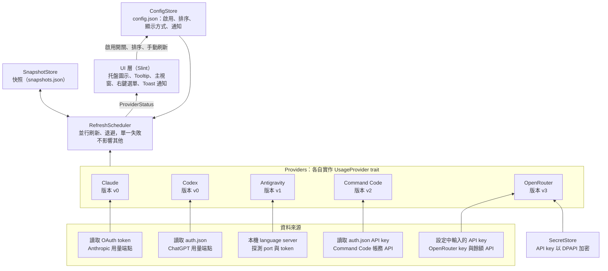
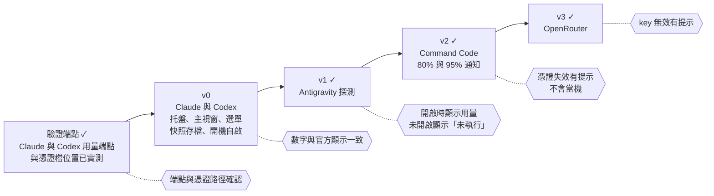

# Windows AI 用量托盤工具 規格書

Nov 9, 2026 · @Ray（2026-11-10 v0–v2 與 OpenRouter 完成後同步；名詞定義見根目錄 `CONTEXT.md`，架構決策見 `docs/adr/`）

## 1. 概述與目標

本專案是 Windows 系統匣常駐的小工具，讓使用者不用開網頁或 CLI，就能一眼看到 Claude、Codex 等 AI 服務的訂閱額度用量與重置時間。靈感來自 macOS 的 CodexBar，但範圍刻意縮小，只做自己需要的功能。

**要解決的問題**：訂閱方案的額度（例如 5 小時視窗、每週額度）分散在各家網頁或 CLI 內，要查就得切換視窗，常常用到被限速才發現。

**目標**

- 在系統匣直接看到「還剩幾 %」：托盤圖示寫著焦點 Provider 最先用完的額度剩餘百分比，外框為該 Provider 的代表色。
- 點擊托盤圖示開啟主視窗，以卡片與進度條顯示每個 Provider 的各個額度視窗與重置倒數；開啟視窗時資料是新的。
- 免輸入密碼：借用 CLI 已登入的憑證（Claude、Codex、Command Code）或本機 App（Antigravity）；只有 OpenRouter 需要在設定貼上 API key。
- 最輕量：單一 Rust 執行檔（exe）、免安裝 runtime、無背景服務、無資料庫。
- 所有使用者設定都在設定視窗操作，使用者不需要編輯任何檔案。

**支援的 Provider**：Claude（訂閱）、Codex（訂閱）、Antigravity、Command Code、OpenRouter。

**成功標準**

- v0 完成後，Claude 與 Codex 用量能正確顯示（首次使用 Rust，時程預留緩衝）。
- 資料與官方網頁或 CLI 顯示的用量誤差在一個背景刷新週期內；開啟視窗時誤差在半個背景刷新間隔內（5 分鐘）。
- 視窗隱藏時常駐記憶體盡量壓低、閒置時 CPU 接近 0，啟動後數秒內出現托盤圖示。2026-11-10 實測正式版：exe 8.3 MB；視窗隱藏時工作集 32 MB、私有記憶體 5 MB；閒置 30 秒 CPU 時間 0 ms。

## 2. 範圍

分三個版本逐步交付，v0 只做 Claude 與 Codex，因為這兩個是訂閱方案且資料來源最明確。

| 版本 | 內容 | 驗收標準 |
| --- | --- | --- |
| v0 | Claude、Codex Provider；托盤數字圖示（焦點 Provider 的剩餘 %、代表色外框、低量轉色、警示標記）；主視窗（總覽與各 Provider 頁籤）顯示各額度視窗剩餘量、進度刻度與重置倒數；設定視窗（Provider 啟用與排序、顯示方式、開機自啟）；背景定期刷新（每 10 分鐘）、開啟視窗時自動刷新；手動刷新；失敗時保留快照並顯示失敗原因；快照存檔（重開機後仍可顯示）；429 退避；右鍵選單（立即刷新、設定、關於、結束）；App 圖示 | 兩個 Provider 的數字與官方顯示一致 |
| v1 ✓ | Antigravity Provider（本機 language server 探測） | Antigravity 開啟時能顯示用量，未開啟時顯示「未執行」 |
| v2 ✓ | Command Code Provider（借用 CLI 的 API key，見 ADR-0004）；80% 與 95% 的 Windows Toast 通知 | 憑證失效時有明確提示，不會當機 |
| v3 ✓ | OpenRouter Provider（設定中輸入 API key，DPAPI 加密儲存） | 額度與餘額正確；key 無效時有明確提示 |

**刻意不做**

- 用量歷史圖表、以本機記錄推算的費用與 token 統計（主視窗只顯示目前額度）。
- 可調整的刷新間隔與通知門檻（固定為程式常數）。
- 瀏覽器 cookie 自動匯入（Windows 上 Chromium cookie 加密複雜，是最大的工程黑洞）。
- Token refresh 流程（見 ADR-0001；過期時提示使用者先執行一次對應 CLI）。
- 超額付費（Claude 的 `spend`、`extra_usage`）的顯示。
- CodexBar 的其他 50 多個 Provider、Widget、Provider 狀態頁輪詢。
- macOS 與 Linux 支援。

## 3. 技術選型

採用 Rust 搭配 Slint，目標是啟動快、常駐記憶體少、單一 exe 免安裝 runtime，同時有能畫出卡片與進度條的好看 UI。

| 項目 | 選擇 | 理由 |
| --- | --- | --- |
| 語言 | Rust（stable） | 原生編譯、無 runtime，啟動快、記憶體低；也是開發者想接觸的新語言 |
| UI | Slint 1.18 以上 | 宣告式 UI，內建 `SystemTrayIcon` 與 `Tooltip` 元素，Windows 上以 `Shell_NotifyIconW` 實作托盤，不需另外裝托盤套件 |
| HTTP | `ureq`（同步） | 每幾分鐘只打少量請求，搭配背景執行緒即可，不引入 tokio，減少體積與複雜度 |
| JSON | `serde` + `serde_json` | Rust 事實標準，設定檔、快照檔與 API 回應共用 |
| Windows API | `windows` crate | DPAPI 加密、登錄檔（開機自啟、通知 AUMID）、行程與連接埠探測（Antigravity）、WinRT Toast |
| 渲染器 | 先用軟體渲染器 | 記憶體最省；實測後再決定是否改用 GPU 渲染器 |
| 發佈 | `cargo build --release` | 單一 exe；release 設定開啟 LTO、`strip`、`panic = "abort"` 縮小體積 |

**授權**：採用 Slint 的 **Royalty-free** 授權，可用於不公開原始碼的桌面應用，條件是揭露使用 Slint：右鍵選單的「關於」開啟設定視窗的關於頁，其中顯示 `AboutSlint` 元件。

**替代方案（未採用）**

- Tauri v2（Rust + WebView2）：UI 最自由，但開啟視窗時 WebView2 的記憶體較高。
- egui：很輕，但外觀偏工具風，不易做出好看的卡片。
- C# WinForms / WPF：開發最快，但需要 .NET runtime，啟動與記憶體較重，WinForms 也很難做出好看的 UI。

## 4. 系統架構



資料由下往上流動：Provider 取得資料並轉成統一的快照，排程器負責刷新與退避，並把每個 Provider 的「快照＋最近失敗原因」交給 UI；UI 只讀取結果，並把使用者的啟用開關寫回設定。新增 Provider 只需新增一個實作 `UsageProvider` trait 的結構。

## 5. Provider 規格

Claude、Codex、Command Code 借用 CLI 已登入的憑證，Antigravity 探測本機 App（App 沒開時改執行 agy CLI 的用量報告），OpenRouter 使用設定中輸入的 API key（官方公開 API）。除 OpenRouter 外皆為非公開端點，已於 2026-11-09／10 實測確認，仍可能改版。

| Provider | 版本 | 認證來源 | 取得方式 | 方案名稱 |
| --- | --- | --- | --- | --- |
| Claude | v0 | `%USERPROFILE%\.claude\.credentials.json` 的 `claudeAiOauth.accessToken`（`expiresAt` 為毫秒，壽命約 8 小時） | `GET https://api.anthropic.com/api/oauth/usage?cedar_ember=1`，header：`Authorization: Bearer <token>`、`anthropic-beta: oauth-2025-04-20`、`User-Agent: claude-cli/<版本> (external, cli)` | `claudeAiOauth.subscriptionType` + `rateLimitTier`（例：`max` + `default_claude_max_5x` → 「Max 5x」） |
| Codex | v0 | `%USERPROFILE%\.codex\auth.json` 的 `tokens.access_token`、`tokens.account_id`（JWT，壽命約 10 天） | `GET https://chatgpt.com/backend-api/wham/usage`，header：`Authorization: Bearer <token>`、`ChatGPT-Account-Id: <account_id>` | 回應的 `plan_type`（例：`plus` → 「Plus」） |
| Antigravity | v1 | 無（本機探測；或 agy CLI 已登入的帳號） | 見下方「Antigravity 探測」 | `GetUserStatus` 的 `userStatus.planStatus.planInfo.planName`（例：「Pro」） |
| Command Code | v2 | `%USERPROFILE%\.commandcode\auth.json` 的 `apiKey`、`userId` | `GET https://api.commandcode.ai/alpha/billing/credits` 與 `/alpha/billing/subscriptions`，header：`Authorization: Bearer <apiKey>` | 訂閱的 `planId` 對照 CLI 內建表（例：`individual-go-v1` →「Go」，月額度 $10） |
| OpenRouter | v3 | 設定視窗輸入的 API key（DPAPI 加密存於 `secrets.bin`） | `GET https://openrouter.ai/api/v1/key` 與 `/api/v1/credits`，header：`Authorization: Bearer <key>` | `is_free_tier` →「免費」或「付費」 |

**Claude 回應解析**

- 優先解析 `limits` 陣列，每筆為一個額度視窗：`kind`（`session`、`weekly_all`、`weekly_scoped`…）、`percent`、`resets_at`（ISO 8601）、`scope.model.display_name`。
- 視窗名稱：`session` →「5 小時」、`weekly_all` →「每週」、`weekly_scoped` →「每週・{display_name}」；未知的 `kind` 仍顯示，名稱用 `kind` 原字串。
- `limits` 不存在時，退回解析舊欄位 `five_hour`、`seven_day`（`utilization`、`resets_at`）；兩者皆無法解析才視為「回應格式改變」。
- 其餘欄位（`spend`、`extra_usage`、各種代號欄位）忽略。

**Codex 回應解析**

- `rate_limit.primary_window` 與 `rate_limit.secondary_window`：`used_percent`、`limit_window_seconds`、`reset_at`（Unix 秒）。
- 視窗名稱由 `limit_window_seconds` 推得：18000 →「5 小時」、604800 →「每週」，其他值換算成小時或天數。
- `additional_rate_limits` 有值時一併顯示。
- 保留重置的明細另外查 `GET https://chatgpt.com/backend-api/wham/rate-limit-reset-credits`（同樣的 `Authorization`、`ChatGPT-Account-Id`，另加 `OpenAI-Beta: codex-1`、`originator: Codex Desktop`）：`credits` 中 `status` 為 `available` 且 `expires_at`（ISO 8601）未過的每一筆算一次，每筆的到期時間不同。不保存每筆的 `id`（兌換用的識別碼）。
- 用量回應的 `rate_limit_reset_credits.applicable_available_count` 是此刻可套用的次數（沒撞到上限時通常為 0）。明細端點失敗時，退回用量回應的 `available_count`（只有次數、沒有到期時間）；明細失敗不影響用量本身。
- Claude 的保留重置（claude.ai「設定 → 用量」的 Reset for free）：查詢加上 `cedar_ember=1`，回應的 `cedar_ember` 區塊才會出現。伺服器依呼叫來源判斷是否提供，因此 User-Agent 採用 Claude Code CLI 的格式 `claude-cli/<版本> (external, cli)`（版本取自 `.claude.json` 的 `lastReleaseNotesSeen`，讀不到時用 `2.1.0`；與 CodexBar 相同做法），否則會得到 `eligible: false`、`ineligible_reason: "surface"`。
  - 需 `eligible: true`。`grants` 中未暫停（`paused: false`）、已開始（`starts_at`）、未到期（`ends_at`）的每筆依 `resets_left` 計入次數，到期時間為 `ends_at`；`usable_now: true` 的計入可套用次數。格式不符的 grant 略過，不保存 grant 的 `id`。
  - 伺服器若以 400／403 拒絕 `cedar_ember` 參數，退回不帶參數的查詢一次，用量照常顯示。

**Antigravity 探測**

- 以 ToolHelp 列舉行程，找出 `language_server*.exe` 且命令列含 `antigravity` 者；以 `NtQueryInformationProcess(ProcessCommandLineInformation)` 讀命令列，取出 `--csrf_token`（必須）、`--extension_server_port`、`--extension_server_csrf_token`。IDE 擴充套件內的 server（`--app_data_dir antigravity-ide`）優先順序較低。
- 以 `GetExtendedTcpTable`（擁有者 PID、只取 LISTEN）列出該行程在聽的連接埠，逐一 `POST https://127.0.0.1:<port>/exa.language_server_pb.LanguageServerService/GetUnleashData`，第一個 200 即為目標；都不通時改用 `http://127.0.0.1:<extension_server_port>`。
- header：`X-Codeium-Csrf-Token: <token>`、`Connect-Protocol-Version: 1`；body：`{"metadata":{"ideName":"antigravity","extensionName":"antigravity","locale":"en","ideVersion":"unknown"}}`。憑證為自簽，**只對 127.0.0.1 停用驗證**（另一個 HTTP agent，拒絕非本機網址）。
- 額度優先取 `RetrieveUserQuotaSummary`：`response.groups[].buckets[]` 的 `remainingFraction`、`resetTime`、`window`（`"5h"`／`"weekly"`）。通用名稱（「Weekly Limit Remaining」）改為「{組名}・5 小時／每週」，組名去掉結尾的「Models」；有專屬名稱的（例：「Gemini 4 Argon Weekly」）照原名。後備為 `GetUserStatus` 的 `clientModelConfigs[].quotaInfo`，分成 Gemini 與 Claude + GPT 兩組取剩最少者。
- App 沒開（或問不到）時，若有安裝 agy CLI，改執行 `agy -p /usage --output-format json --print-timeout 90s` 取得非互動的用量報告：`{"status":"SUCCESS","command":{"name":"usage","data":{"groups":[…]}}}`，`data` 與 `RetrieveUserQuotaSummary` 同格式但欄位為 snake_case（`name`、`id`、`remaining_fraction`、`reset_time`、`window`）。只讀用量，不送出模型提示、不耗額度。
  - 執行檔：`ANTIGRAVITY_CLI_PATH`（有設定時只用它）→ `%LOCALAPPDATA%\agy\bin\agy.exe` → PATH 中的 `agy.exe`。
  - 先以 `agy --version` 確認版本 ≥ 1.1.11（更舊的版本可能把 `/usage` 當成提示送給模型）；同一個執行檔只問一次。agy 1.2.2 起本機 HTTPS 服務需要拿不到的 CSRF token，因此只用報告模式。
  - 環境變數 `AGY_CLI_DISABLE_AUTO_UPDATE=true`、`BROWSER` 指向不存在的程式；不顯示主控台視窗；整個行程樹放進 Job Object，結束或逾時（100 秒）時一併終止；工作目錄 `%TEMP%\AiBar-agy`；輸出上限 1 MB。
  - 每次約 5–9 秒。報告沒有方案名稱，沿用上一份快照的方案。`status` 不是 `SUCCESS` 時視為 `NotLoggedIn`（提示執行 `agy` 登入）。
  - 做法參考 CodexBar（2026-11 實測 agy 1.5.3）。
- App 與 agy CLI 都找不到時為 `NotRunning`：不算失敗、不加警示標記，卡片以一般文字提示「Antigravity 未執行（也找不到 agy CLI），開啟 App 後會自動更新」。
- 備註：從 VS Code 終端機啟動 Antigravity 時，若環境變數 `ELECTRON_RUN_AS_NODE=1`（VS Code 擴充主機會設定）會讓它直接退出；這只影響開發測試，不影響 AIBar。

**Command Code 回應解析**

- `credits.windowLimits.fiveHour`、`weekly`：`used / cap` 為已使用比例，`resetAt` 為毫秒（0 表示視窗尚未開始，不顯示重置時間）。
- 每月：方案月額度（訂閱 `status` 為 `active` 時）與剩餘 `monthlyCredits` 取大者，加上 `purchasedCredits`、`freeCredits` 為總額；已用 = 總額 − 剩餘。重置時間為訂閱的 `currentPeriodEnd`，視窗長度為 `currentPeriodStart` 到 `currentPeriodEnd`。算法與 CLI 的 `/usage` 一致。
- 卡片另顯示「本期已用 $4.33 / $10.00」。

**OpenRouter 回應解析**

- `/api/v1/key` 的 `data.limit`（美元）有值時，顯示一個額度視窗：名稱依 `limit_reset`（`daily`／`weekly`／`monthly` →「每日上限／每週上限／每月上限」，null →「Key 上限」），已用 = (`limit` − `limit_remaining`) / `limit`；重置時間依 UTC 午夜、週一、每月 1 日推算。
- `/api/v1/credits` 的 `data.total_credits`、`total_usage` 取得到時，顯示「儲值餘額」視窗（無重置）與「本期已用 $x / $y」；取不到（部分 key 沒有權限）時只顯示 `usage_monthly`（「本月已用 $x（無上限）」）。
- 401／403 視為 key 無效，提示到設定重新輸入。

**共通規則**

- API 回傳幾個額度視窗就顯示幾個，不寫死清單；0% 的視窗照樣顯示。
- 每次刷新都重新讀取憑證檔，CLI 更新憑證後下一次刷新即生效。
- Token 過期時不自行 refresh（ADR-0001），顯示「Token 已過期，請先執行一次 `claude`（或 `codex`）」。若憑證檔的到期時間已過，直接判定過期，不發送請求。
- 絕不寫入或修改 CLI 的憑證檔，只讀取。
- 每個 Provider 的端點細節集中在各自的模組（`providers/<name>.rs`），端點改版時只需修改一個檔案。

## 6. 資料模型

每個 Provider 的顯示內容由兩部分組成：**快照**（最後一次成功取得的資料）與**最近一次刷新的失敗原因**。抓取失敗不會覆蓋快照，所以卡片永遠能顯示最後已知的數字。

```rust
pub trait UsageProvider: Send + Sync {
    fn id(&self) -> &'static str;
    /// 憑證是否存在（只檢查，不讀內容）；用於首次啟動自動偵測
    fn credentials_present(&self) -> bool;
    /// 目前登入帳號的雜湊（只讀本機檔案，不連網），用於丟棄別的帳號的快照
    fn current_account_hash(&self) -> Option<String>;
    /// 背景刷新間隔（統一 10 分鐘；Provider 可覆寫，目前都沿用預設）
    fn refresh_interval(&self) -> Duration;
    fn fetch(&self) -> Result<Snapshot, FetchFailure>;
}

#[derive(Clone, Debug, Serialize, Deserialize)]
pub struct Snapshot {
    pub plan: Option<String>,              // 方案名稱，例如「Max 5x」「Plus」
    pub account_hash: String,              // 帳號識別的雜湊，不存原始 id
    pub windows: Vec<UsageWindow>,
    pub credits: Option<Credits>,          // 金額型額度（Command Code、OpenRouter）
    pub resets: Option<ResetBank>,         // 保留重置：每一次的到期時間（最快的在前）、此刻可套用次數（Codex）
    pub fetched_at: SystemTime,
}

pub struct Credits {
    pub used: f64,                         // 本期已用（美元）
    pub limit: f64,                        // 上限（美元）；0 表示無上限
}

#[derive(Clone, Debug, Serialize, Deserialize)]
pub struct UsageWindow {
    pub name: String,                      // 例如「5 小時」「每週」「每週・Fable」
    pub used_percent: f64,                 // 0.0–100.0
    pub resets_at: Option<SystemTime>,
    pub window_secs: Option<u64>,          // 視窗長度，用於計算進度；推不出來時為 None
}

#[derive(Clone, Debug)]
pub enum FetchFailure {
    NotLoggedIn,                           // 找不到憑證檔
    TokenExpired,                          // 憑證到期時間已過，或回應 401／403
    RateLimited { retry_at: SystemTime },  // 回應 429
    Network,                               // 逾時、連線失敗、5xx
    BadResponse,                           // 回應格式無法解析
    NotRunning,                            // Antigravity 未執行（不算失敗）
}

/// 排程器交給 UI 的每個 Provider 狀態
#[derive(Clone, Debug)]
pub struct ProviderStatus {
    pub provider_id: &'static str,
    pub snapshot: Option<Snapshot>,
    pub last_failure: Option<FetchFailure>, // 最近一次刷新成功時為 None
    pub refreshing: bool,
    pub refresh_interval: Duration,
}
```

**衍生規則**

| 概念 | 規則 |
| --- | --- |
| 已重置 | 額度視窗的 `resets_at` 已過，用量視為 0%，卡片顯示「已重置」 |
| 舊快照 | `fetched_at` 超過該 Provider 的 3 個背景刷新間隔（30 分鐘） |
| 帳號不符 | 啟動時讀到的快照 `account_hash` 與目前憑證不同，丟棄該快照 |

## 7. UI 與互動

UI 由托盤圖示、Tooltip、右鍵選單與一個主視窗組成，皆以 Slint 繪製。只顯示**啟用**的 Provider。主視窗採一般視窗而非彈出面板，理由見 ADR-0002。

**托盤圖示**（理由見 ADR-0003）

- **焦點 Provider**：主視窗停在「總覽」時為排序第一的啟用 Provider；切到某個 Provider 頁籤時為該 Provider。最後選的頁籤存入 `config.json`，視窗隱藏或重開機後沿用。
- 圖示中央的數字是焦點 Provider 各額度視窗中**剩餘最少**者的剩餘百分比（已重置的視窗以剩 100% 計）；100% 顯示「滿」。不論設定為顯示剩餘或已使用，圖示一律顯示剩餘。
- 外框為焦點 Provider 的代表色（Claude 橘、Codex 青、Antigravity 綠、Command Code 紫、OpenRouter 藍紫）。
- 剩 10%–29% 時底色轉黃、低於 10% 轉紅；焦點 Provider 為舊快照或沒有快照時外框轉灰、數字變淡（沒有快照顯示「–」）。
- 焦點 Provider 有失敗原因時右下角疊加「!」警示標記（`NotRunning` 除外）。
- 以 GDI 依目前 DPI 的小圖示尺寸繪製文字（不縮放點陣），不需另備圖檔。
- Tooltip 第一行為焦點 Provider 的摘要，例如「Codex・每週 剩 59%・1 天 18 小時後重置」；其後每個啟用 Provider 一行列出各額度視窗剩餘量；最後一行為更新時間。

**App 圖示**

- exe（build.rs 產生 16–256px 的 .ico 嵌入，並寫入檔案描述「AIBar」）、工作列與標題列使用固定的 App 圖示：深色圓角方塊內三根由低到高、分別為 Provider 代表色的長條。狀態由托盤數字表達，App 圖示不隨狀態變化。

**主視窗**

- 一般視窗：有標題列，可拖動、可調整大小（最小 360×200）；程式啟動時不顯示，只有托盤。
- 左鍵點擊托盤圖示：視窗不在最前面時顯示並移到最前面，已在最前面則隱藏。點托盤會讓視窗先失焦，故失焦 400ms 內仍視為在最前面。
- 按 X 或 Esc 隱藏回托盤，不結束程式；結束只從右鍵選單。
- 第一次開啟時出現在游標所在螢幕工作區的正中央；隱藏、按 X 或結束程式時把位置與大小存入 `config.json`，之後沿用。存下的位置已不在任何螢幕上（例如外接螢幕拔除）時退回置中。
- 顯示後約 30ms 以 `SetForegroundWindow` 取得前景（托盤點擊後 Shell 會授予前景權限）。
- 視窗只建立一次，隱藏時保留；不在每次開啟時重建（重建會經過預設大小的過渡，造成位置跳動與畫面殘缺）。
- 開啟時，若某 Provider 的快照超過其背景刷新間隔的一半且不在退避期間，自動刷新該 Provider。
- 頂部為頁籤列：「總覽」與每個啟用 Provider 一個頁籤（依設定的排序，名稱前有代表色圓點），右側為「立即刷新」與「設定」圖示按鈕；內容超出視窗高度時捲動。
- **總覽**：最上方一行「最先用完：{Provider} {額度視窗}，剩 N%」與更新時間；每個啟用 Provider 一張卡片，標題列為代表色字母方塊、名稱、方案標籤，各額度視窗如下。
- **Provider 頁籤**：大標題（名稱、方案、更新時間）；有失敗原因時顯示提示框（`TokenExpired`、`NotLoggedIn` 附「複製指令」按鈕）；各額度視窗同總覽，但另顯示絕對重置時間；下方列出來源、下次刷新時間與「開啟官方用量頁」連結。
- **額度視窗**：第一行為名稱、「剩餘 72%」（或「已使用 28%」，依設定）與重置倒數；第二行為進度條，長度代表所選顯示方式的量，顏色平常為 Provider 代表色，剩 10%–29% 轉黃、低於 10% 轉紅；第三行為進度說明。
- **進度刻度**：可推得視窗長度時（Codex 的 `limit_window_seconds`；Claude 的 `session` 5 小時、`weekly_*` 7 天），進度條上以白色刻度標出「依時間比例此刻應剩的量」，第三行寫「比預期少用 N% · 可撐到重置」或「比預期多用 N% · 約 X 後用完」（以目前平均速度推算用完時間，早於重置才顯示）。推不出視窗長度時不顯示刻度與說明。
- 重置倒數：24 小時內顯示「2 時 13 分後重置」，超過 24 小時顯示「3 天 16 小時後重置」，重置時間已過顯示「已重置」；Provider 頁籤另顯示絕對時間（「今天 01:10」「11/13（五）16:00」）。
- 金額型 Provider（Command Code、OpenRouter）在卡片標題下顯示「本期已用 $4.33 / $10.00」，Provider 頁籤的資訊列另有「費用」一列。
- 有保留重置時，卡片標題下顯示「已存 2 次重置・最快 11/30（一）03:41 到期」（可套用時改為「可套用 N 次重置」）；最快到期的在 3 天內到期時以黃色顯示。Provider 頁籤的資訊列另有「重置」一列，逐次列出到期時間與剩餘時間，最後一行寫套用方式（Codex：撞到上限時在 codex 中輸入 `/usage`；Claude：claude.ai 或桌面版「設定 → 用量」的 Reset for free）。AIBar 只顯示，不替使用者套用。
- 「更新於 N 分鐘前」與重置倒數每 30 秒重新計算。
- 配色跟隨 Windows 深色／淺色模式。

**卡片顯示規則**

| 情況 | 卡片顯示 |
| --- | --- |
| 有快照、刷新成功 | 各額度視窗與「更新於 N 分鐘前」 |
| 有快照、最近一次刷新失敗 | 照樣顯示快照與取得時間，另加一行失敗原因 |
| 沒有快照 | 只顯示失敗原因，不顯示進度條 |
| 刷新中 | 保留目前數字，卡片角落顯示轉圈圖示 |

**失敗原因文字**

| 失敗原因 | 文字 |
| --- | --- |
| `NotLoggedIn` | 找不到登入資訊，請先執行 `claude`（或 `codex`） |
| `TokenExpired` | Token 已過期，請先執行一次 `claude`（或 `codex`） |
| `RateLimited` | 限流中，HH:MM 自動重試 |
| `Network` | 無法連線，下次排程將重試 |
| `BadResponse` | 回應格式改變 |
| `NotRunning` | Antigravity 未執行（也找不到 agy CLI），開啟 App 後會自動更新（一般文字，非警示） |

**右鍵選單**

- 立即刷新
- 設定…
- 關於（開啟設定視窗的關於頁）
- 結束

**設定視窗**

- 一般視窗，左側分類：一般、Provider、通知、關於。由主視窗的設定按鈕或右鍵選單「設定…」開啟。
- 一般：開機時自動啟動（開關）、用量顯示方式（剩餘／已使用，預設剩餘）。
- Provider：每個 Provider 一列，含 ▲▼ 排序按鈕、代表色字母方塊、偵測狀態（例如「已偵測到 Claude Code 登入 · Pro」）與啟用開關。OpenRouter 另有一列密碼輸入框與「儲存」「清除」按鈕：儲存後自動啟用並立即刷新，清除後停用；沒有 key 時開關停用。
- 通知：「額度快用完時通知」開關（預設開啟）。
- 關於：版本、簡介與 `AboutSlint`（Slint 授權要求）。
- 變更立即生效並寫入 `config.json`，不需按儲存。

**通知**

- 每個額度視窗的**已使用量**跨過 80% 與 95% 時各發一次 Windows Toast（標題「Codex 每週 已用 82%」，內文「剩餘 18%，1 天 18 小時後重置」）；直接跳過 80% 時只發一則。該視窗重置（重置時間改變）後才會再次通知。
- 以 WinRT `ToastNotificationManager` 發送，不需額外 crate。免安裝程式需要 AppUserModelID：啟動時登錄 `HKCU\Software\Classes\AppUserModelId\RayLiu.AIBar`（`DisplayName`、`IconUri` 指向 `%APPDATA%\AiBar\icon.png`），並以 `SetCurrentProcessExplicitAppUserModelID` 套用。
- 已通知紀錄存於 `notified.json`（鍵為「Provider|額度視窗|重置時間」），重開機不重複通知；重置時間已過的紀錄自動清除。
- `aibar --notify-test` 發一則測試通知，用來確認 Windows 通知設定沒有擋住 AIBar。

## 8. 設定、儲存與資安

程式只讀取 CLI 已有的憑證；自己寫入的檔案都在 `%APPDATA%\AiBar\`，唯一需要保管的機密是 OpenRouter 的 API key，以 DPAPI 加密後存放。

| 檔案 | 內容 | 說明 |
| --- | --- | --- |
| `config.json` | Provider 啟用與排序、顯示方式、最後選的頁籤、視窗位置與大小 | 由設定視窗與主視窗讀寫，使用者不需編輯 |
| `snapshots.json` | 各 Provider 的快照（含金額型額度與保留重置） | 每次刷新成功時寫入，啟動時讀取；讀不到或格式錯誤時視為沒有快照 |
| `aibar.log` | 日誌（時間、Provider、狀態碼、耗時、錯誤種類） | 超過 1 MB 改名為 `aibar.log.old`，最多保留兩份；debug 版同時印到主控台；單元測試不寫入 |
| `secrets.bin` | OpenRouter API key（`{"openrouter": "…"}` 整份加密） | `CryptProtectData`（範圍 `CurrentUser`）加密 |
| `notified.json` | 已通知紀錄 | 見第 7 節「通知」 |
| `icon.png` | Toast 通知用的 App 圖示 | 啟動時產生 |

```json
{
  "providers": [
    { "id": "claude", "enabled": true },
    { "id": "codex", "enabled": true },
    { "id": "antigravity", "enabled": false },
    { "id": "commandcode", "enabled": true },
    { "id": "openrouter", "enabled": false }
  ],
  "display": "remaining",
  "selected_tab": "overview",
  "window": { "x": 1450, "y": 420, "width": 460, "height": 640 },
  "notifications": true
}
```

- 首次啟動（`config.json` 不存在）：憑證檔存在的 Provider 預設啟用，其餘停用，結果寫入 `config.json`；之後只依 config。`providers` 的陣列順序即顯示順序；之後新增的 Provider 會附加在最後，偵測得到登入憑證的預設啟用。
- 刷新間隔（10 分鐘）、開啟視窗自動刷新門檻（刷新間隔的一半）、手動刷新下限（1 分鐘）、顏色門檻（70／90）、通知門檻（80／95）皆為程式常數，不可設定。
- 開機自啟以登錄檔為唯一來源：`HKCU\Software\Microsoft\Windows\CurrentVersion\Run`，設定視窗的開關直接讀寫登錄檔，不需系統管理員權限。使用者在工作管理員或「設定 → 應用程式 → 啟動」停用時，Windows 會在 `Explorer\StartupApproved\Run` 記下停用標記（第一個位元組為奇數）：判斷是否啟用要一併檢查，從 AIBar 開啟時清除該標記。

**機密處理原則**

1. Claude 與 Codex 的 token 只在記憶體中使用，不複製、不寫入任何檔案、不寫入日誌。
2. 絕不修改 CLI 的憑證檔，避免破壞使用者登入狀態。
3. `snapshots.json` 不含 token、email、原始帳號 id；帳號只存雜湊值（Claude 用 `organizationUuid`、Codex 用 `account_id`）。
4. OpenRouter API key 以 `CryptProtectData`（範圍 `CurrentUser`）加密後存於 `secrets.bin`；設定視窗只顯示「已儲存」，不回填 key。
5. 日誌不記錄 token、API key 或回應內容，只記錄 Provider、狀態碼與耗時。
6. 停用 TLS 憑證驗證只用於 Antigravity 的本機 language server，且只接受 `127.0.0.1` 網址。
7. 網路請求僅連向各 Provider 的官方網域，不使用任何第三方分析或回報服務。

## 9. 刷新與錯誤處理

各 Provider 並行、彼此獨立，單一 Provider 失敗不影響其他；只有啟用的 Provider 會被刷新。

**刷新時機**

| 觸發 | 規則 | 遵守退避 |
| --- | --- | --- |
| 啟動 | 先載入 `snapshots.json`（帳號雜湊與目前登入不符的捨棄）；快照未滿一個背景刷新週期的等到期再刷新，其餘立即刷新（避免頻繁重開程式時打到限流） | 是 |
| 背景排程 | 每 10 分鐘（開啟視窗時資料超過 5 分鐘會自動刷新，背景只需讓托盤與通知大致即時；Claude 端點限流以帳號計，也不宜更頻繁） | 是 |
| 開啟視窗 | 快照超過該 Provider 刷新間隔的一半時刷新 | 是 |
| 手動（視窗按鈕、右鍵「立即刷新」） | 立刻刷新全部啟用的 Provider；同一 Provider 距上次送出未滿 1 分鐘則略過，避免連按觸發限流 | **否** |
| 從睡眠恢復 | 排程器每分鐘以系統時間檢查是否到期，恢復後最慢 1 分鐘內補上刷新 | 是 |

- 每個請求逾時 10 秒。
- 同一 Provider 前一次刷新尚未結束時，不重疊發送新請求。

**錯誤對應**

| 情況 | 失敗原因 | 行為 |
| --- | --- | --- |
| 找不到憑證檔 | `NotLoggedIn` | 不發送請求 |
| 憑證到期時間已過 | `TokenExpired` | 不發送請求；下次刷新重讀憑證檔 |
| 回應 401 或 403 | `TokenExpired` | 同上 |
| 網路逾時、連線失敗或 5xx | `Network` | 下次排程照常重試 |
| 回應格式無法解析 | `BadResponse` | 日誌記錄狀態碼（不含內容） |
| 回應 429 | `RateLimited` | 該 Provider 退避：間隔加倍，上限 30 分鐘；有 `Retry-After`（秒）且更晚時以它為準；成功後恢復原本的刷新間隔 |
| Antigravity 行程不存在且沒有 agy CLI | `NotRunning` | 不視為錯誤，不加警示標記 |

所有情況都保留既有快照。

## 10. 專案結構與發佈

單一 Cargo 專案，放在 repo 根目錄，不拆 workspace。

```
AIBar/
├── AGENTS.md
├── README.md                 // 說明（中文為主）；README.en.md 為英文版
├── LICENSE                   // MIT
├── CONTEXT.md                // 名詞定義
├── Cargo.toml
├── build.rs                  // 編譯 .slint；產生 .ico 並嵌入圖示與檔案資訊
├── docs/
│   ├── spec.md               // 本規格書
│   ├── adr/                  // 架構決策
│   └── agents/               // agent skill 設定
├── ui/
│   ├── app.slint             // 匯出所有頂層元件
│   ├── tray.slint            // SystemTrayIcon 與右鍵選單
│   ├── main_window.slint     // 主視窗：頁籤、卡片、進度條與進度刻度
│   └── settings.slint        // 設定視窗：一般、Provider、關於
└── src/
    ├── main.rs               // 進入點、單一執行個體、事件迴圈
    ├── model.rs              // Snapshot、UsageWindow、FetchFailure、ProviderStatus
    ├── view.rs               // 模型轉畫面：卡片、進度、托盤內容與 Tooltip、時間文字
    ├── main_window.rs        // 主視窗顯示／隱藏、位置記憶、前景
    ├── tray_icon.rs          // 繪製托盤數字圖示（GDI 文字）與 App 圖示
    ├── icon_art.rs           // 共用繪圖與 App 圖示（build.rs 也引用）
    ├── platform.rs           // 剪貼簿、開啟網址
    ├── scheduler.rs          // 刷新排程與退避（背景執行緒 + channel）
    ├── config.rs             // config.json 讀寫、首次啟動自動偵測
    ├── snapshot_store.rs     // snapshots.json 讀寫
    ├── autostart.rs          // 登錄檔 Run 鍵與 StartupApproved
    ├── applog.rs             // 日誌與輪替（log! 巨集）
    ├── secret.rs             // DPAPI 加解密（OpenRouter API key）
    ├── notify.rs             // Toast 通知與已通知紀錄
    └── providers/
        ├── mod.rs            // UsageProvider trait
        ├── claude.rs
        ├── codex.rs
        ├── antigravity.rs    // v1：本機 language server 探測
        ├── command_code.rs   // v2
        └── openrouter.rs     // v3
```

**專案重點**

- 依賴：`slint`（關閉預設 feature，只啟用 `std`、`compat-1-2`、`accessibility`、`backend-winit`、`renderer-software`、`system-tray`、`unstable-winit-030`）、`slint-build` 與 `winresource`（build dependency；後者需 Windows SDK 的 rc.exe）、`ureq`、`serde`、`serde_json`、`chrono`（本地時區格式化重置時間）、`windows`。
- 隱藏主控台視窗：`main.rs` 開頭加 `#![windows_subsystem = "windows"]`。
- 單一執行個體：以具名 Mutex（`Local\AIBar.SingleInstance`）防止重複啟動；第二份直接結束。
- 開機自啟路徑：正式版啟動時若開機自啟已開啟，把登錄的路徑更新為目前的執行檔（開發版不更新）。
- 執行緒模型：Slint UI 跑在主執行緒；排程器跑在背景執行緒，各 Provider 的請求在其中執行，結果透過 `slint::invoke_from_event_loop` 送回 UI 更新。
- `[profile.release]`：`opt-level = "z"`、`lto = true`、`codegen-units = 1`、`strip = true`、`panic = "abort"`。

**開發環境**

- 安裝 Rust（rustup，目標為 `x86_64-pc-windows-msvc`）。
- 安裝 Visual Studio Build Tools，勾選「使用 C++ 的桌面開發」（含 Windows SDK），Rust 的 MSVC 工具鏈需要它。
- 編輯器可用 VS Code 搭配 rust-analyzer 與 Slint 擴充套件。

**建置與發佈**

```
# 開發
cargo run

# 發佈：單一 exe，位於 target\release\aibar.exe
cargo build --release
```

## 11. 開發里程碑



v0 先交付 Claude 與 Codex，其餘依序加入；六角形為進到下一階段前的驗收標準。

1. ~~用 curl 或 PowerShell 實測 Claude 與 Codex 端點~~（2026-11-09 完成）。
2. 安裝 Rust 工具鏈與 C++ 建置工具（第 10 節），~~建立 Cargo 專案並跑通 Slint 的托盤與主視窗~~（2026-11-09 完成）；接著完成資料模型、設定與快照存取。
3. 實作 Claude 與 Codex Provider、排程與退避，接上托盤圖示、主視窗與右鍵選單（含開機自啟、關於）。
4. ~~加入 Antigravity 探測（v1）~~（2026-11-10 完成）。
5. ~~加入 Command Code 與 Toast 通知（v2）~~（2026-11-10 完成；改用 CLI 的 API key，見 ADR-0004）。
6. ~~加入 OpenRouter（v3）~~（2026-11-10 完成）。

## 12. 風險與待驗證事項

最大的風險是用量端點為非公開，且憑證檔位置與格式可能變動，所以每個 Provider 隔離成獨立模組，並在解析失敗時保留快照。

| 風險 | 影響 | 對策 |
| --- | --- | --- |
| Claude 與 Codex 用量端點為非公開，可能隨時改版 | 該 Provider 無法取得新資料 | 端點細節集中於單一模組；Claude 有新舊兩種欄位可退回；失敗時保留快照並顯示「回應格式改變」 |
| 憑證檔位置或格式改變 | 無法讀取 token | 顯示「找不到登入資訊」；路徑集中於 Provider 模組 |
| Claude token 約 8 小時過期 | 長時間未開 Claude Code 時無新資料 | 不自行 refresh（ADR-0001）；保留快照並提示執行 CLI |
| 頻繁請求被限流（實測 Claude 端點以帳號計，同帳號在其他裝置或工具查詢也會累計；429 回應不帶限流標頭） | 更久拿不到資料 | 背景刷新 10 分鐘；開啟視窗門檻為刷新間隔一半；手動刷新 1 分鐘下限；遵守 429 退避與 Retry-After；失敗時保留快照；啟動時快照未滿一個間隔不刷新 |
| Command Code 帳務 API（`/alpha/…`）為非公開且標示 alpha | 改版後無法取得資料 | 端點集中於單一模組；訂閱資訊取不到時仍顯示 5 小時與每週視窗 |
| Antigravity 本機探測屬實驗性做法；Google 未提供官方額度 API | 版本更新後可能失效 | 只讀本機 language server、不連 Google；額度摘要失敗時退回 GetUserStatus；失效時顯示錯誤，不影響其他 Provider |
| 帳號層級的使用規範 | 使用非公開端點可能不被官方支援 | 僅供個人或少數同事使用，低頻率輪詢 |
| 首次使用 Rust，編譯錯誤與所有權概念需適應 | 開發時程可能超出預期 | 由 AI 撰寫、開發者逐檔閱讀；採用背景執行緒加 channel 的簡單並行模型，不引入 async runtime |
| Slint 的系統托盤是 1.17 才加入的新功能，仍有缺陷（1.18.1 若在圖示設定前建立任何視窗，托盤會建立失敗且不重試） | 托盤圖示不出現 | 已以原型驗證（2026-11-09）；`Tray::new()` 後立即設定圖示，再建立其他視窗 |

**待驗證清單**

- [x] Claude Code 憑證檔在 Windows 上的實際路徑與欄位名稱
- [x] Claude 用量端點的路徑、必要 header 與回應欄位
- [x] `%USERPROFILE%\.codex\auth.json` 的欄位名稱（token 與 account id）
- [x] Codex 用量端點的路徑與回應欄位
- [x] Slint 托盤的點擊事件能否取得位置（`clicked` 不帶座標；改用一般視窗後不再需要，見 ADR-0002）
- [x] Slint 托盤能否偵測左鍵點擊與右鍵選單、能否動態更換圖示與 Tooltip
- [x] Windows 睡眠恢復事件的取得方式（不監聽電源事件，改由排程器每分鐘以系統時間檢查）
- [x] Antigravity 在 Windows 上 language server 的行程名稱與命令列參數（`language_server.exe`，`--csrf_token`、`--app_data_dir antigravity`）
- [x] Command Code 用量的資料來源（CLI 的 `auth.json` API key 與 `/alpha/billing/*`，不需 cookie）
- [x] OpenRouter 額度 API（`/api/v1/key`、`/api/v1/credits`）
